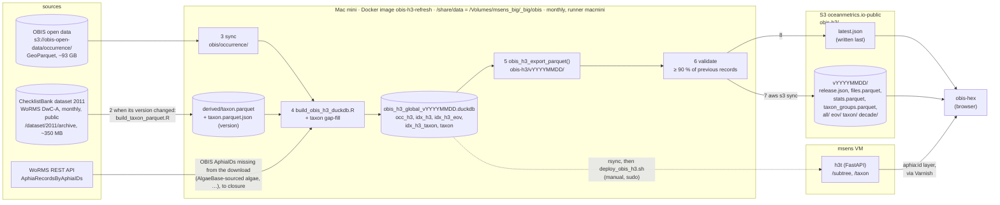

# data-raw

Build and deploy scripts for the OBIS H3 store and the `obis-h3` web release. The monthly release runs on the
Mac mini in Docker (`run_refresh_docker.sh`); `deploy_obis_h3.sh` and the h3t service stay on msens (`ssh
msens`). Not on a laptop. Excluded from the built package (`.Rbuildignore`).

| script | does |
|---|---|
| `build_taxon_parquet.R` | WoRMS `taxon.parquet` from a DwC `taxon.txt`; run by the monthly refresh when ChecklistBank's WoRMS version changes (step 2) |
| `build_obis_h3_duckdb.R` | builds `/share/data/obis/obis_h3_global_vYYYYMMDD.duckdb` from the local OBIS parquet snapshot (in the obis-h3 image, or msens's `plumber` container) |
| `deploy_obis_h3.sh` | swaps the store the `h3t` tile service serves (needs sudo), restarts h3t, verifies |
| `refresh_obis_h3.sh` | the monthly `obis-h3` release for the obis-hex app: sync, build, export, validate, upload, `latest.json` |
| `run_refresh_docker.sh` | runs `refresh_obis_h3.sh` in the `docker/Dockerfile` image on the Mac mini (Colima), data on the external drive; copies the new store to msens for h3t |

## Monthly `obis-h3` refresh (`refresh_obis_h3.sh`)

The obis-hex app reads a static release of hive-partitioned Parquet from
`s3://oceanmetrics.io-public/obis-h3/<release>/` (public
`https://s3.us-east-1.amazonaws.com/oceanmetrics.io-public/obis-h3/<release>/`). The pointer to the current
release is `obis-h3/latest.json`:

```json
{"release": "v20261001", "base": "https://s3.us-east-1.amazonaws.com/oceanmetrics.io-public/obis-h3/v20261001/",
 "obis_snapshot": "2026-10-01", "built_at": "2026-10-02T04:12:09Z"}
```



The same store feeds both paths: the static release (steps 3–6, every precomputed layer) and the h3t
service, which answers the one query a release cannot hold, the children of any WoRMS AphiaID. h3t moves
to a new store only when `deploy_obis_h3.sh` is run by hand on msens (below); the wrapper copies the store there. How the app requests these files is
in the obis-hex README, ["How it runs"](https://github.com/oceanmetrics/obis-hex#how-it-runs).

`latest.json` is written **last**, with `Cache-Control: max-age=300`, only after the release is uploaded and its
file count checked, so a failed run never moves the pointer. Release folders are immutable and never deleted,
so older releases stay for rollback.

### Where it runs: the Mac mini, in Docker

`run_refresh_docker.sh` (on the mini, from `~/Github/marinebon/obisindicators`) runs the whole refresh in one
throwaway container of the image in `docker/Dockerfile`: R 4.6.1, CRAN packages from the Posit Package Manager
snapshot of 2026-09-15 with duckdb pinned to 1.5.5 (h3t reads the store with 1.5.6; a newer DuckDB opens an
older one's store, not the reverse), the h3, spatial and
httpfs extensions installed in the image, the AWS CLI v2. The package's R code is not in the image: it is
sourced from the mounted checkout, so a code change needs no rebuild, and `release.json` takes the version from
the checkout's `DESCRIPTION`.

- **Docker** is Colima (`brew install colima docker`), profile `obis-h3` (8 CPU, 24 GiB, virtiofs). The wrapper
  starts the VM, builds the image (cached), runs the refresh and stops the VM again, so the mini's memory is free
  between runs. It works from a non-GUI shell (ssh, tmux, the runner).
- **Data** on the external drive: `/Volumes/msens_big/_big/obis` is mounted at `/share/data`, so the script's
  msens paths hold unchanged (`obis/occurrence/`, `obis/obis_h3_global_*.duckdb`, `obis/log/`, `obis-h3/<release>/`,
  `derived/taxon.parquet`). The wrapper refuses to run if that folder is on the internal disk (drive not mounted).
- **Budgets** (mini, 48 GB): build 16GB / 6 threads / 200GB spill, export 12GB / 6 threads (env-overridable).
- **One run at a time**: the container's name (`obis-h3-refresh`; exit 3 if it exists).
- **AWS**: `~/.aws` mounted read-only; `AWS_PROFILE` is passed on.
- **After a published release** the new store is rsynced to msens `/share/data/obis/` for h3t (a failure only
  warns); then on msens, by hand: `deploy_obis_h3.sh` (below). `--no-msens` skips the copy.
- **Done marker** `obis/log/refresh_YYYYMMDD.done` on the drive, next to the log.

```bash
data-raw/run_refresh_docker.sh --dry-run                # VM + image + the script's dry run
data-raw/run_refresh_docker.sh                          # the monthly run
data-raw/run_refresh_docker.sh --keep-vm --skip-sync --skip-build --skip-upload --release v20260728   # test an export
```

The same `refresh_obis_h3.sh` still runs on msens with R in the `plumber` container (the default
`BUILD_CONTAINER=plumber`); inside the image it runs R directly (`BUILD_CONTAINER=""`).

### `refresh_obis_h3.sh`

```bash
data-raw/refresh_obis_h3.sh                    # full run (hours; ~93 GB sync, build, export, upload)
data-raw/refresh_obis_h3.sh --dry-run          # print every step, change nothing
data-raw/refresh_obis_h3.sh --skip-sync --skip-build --release v20260828   # re-export + upload from disk
```

Flags: `--skip-sync`, `--skip-build`, `--skip-export`, `--skip-upload` (also skips `latest.json`),
`--release vYYYYMMDD` (default the UTC date of the sync, recorded in `/share/data/obis/occurrence.synced_at`),
`--dry-run`. Paths and limits are env-overridable (list in the script header). Log:
`/share/data/obis/log/refresh_YYYYMMDD.log`. One run at a time (`flock`, exit 3 if locked; in Docker, the container name).

Steps:

1. **Preflight**: at least 110 GB free on `/share/data/obis` (`MIN_FREE_GB`), else exit 2 naming the prunable
   old stores. A partial sync would silently build from a truncated snapshot. Also checks AWS credentials.
2. **WoRMS taxonomy** (only when the store is built; `--skip-taxonomy` to keep it, `--taxonomy-only` to run just
   this): compare the `version` of ChecklistBank dataset 2011 (`api.checklistbank.org/dataset/2011`: WoRMS's own
   monthly DwC-A, re-imported there, public, no login) with `derived/taxon.parquet.json`. When it changed,
   download `/archive` (~350 MB, kept as `derived/worms/checklistbank_2011_v<version>.zip`), extract
   `taxon.txt`, run `build_taxon_parquet.R`, check it has over a million rows, swap it in and record the version
   (`taxon.parquet.json`; `release.json` `worms_version`). If ChecklistBank is unreachable the existing parquet is
   kept with a warning. WoRMS publishes on the 1st and ChecklistBank imports it some days later (2026-10-01 was
   imported on the 9th), so a run on the 1st usually uses the previous month's taxonomy. Took ~45 s on the mini.
3. **Sync** `s3://obis-open-data/occurrence/` to `/share/data/obis/occurrence/` (anonymous).
4. **Build** `Rscript data-raw/build_obis_h3_duckdb.R` from the local parquet (in the image, or `docker exec plumber`
   on msens), with the guards `OBIS_MEMORY`, `OBIS_THREADS`, `OBIS_MAX_TEMP` (script defaults 7GB, 2, 20GB for
   msens; the wrapper passes the mini's). It never
   sets `OBIS_GLOBAL=true`: streaming from S3 OOM-wedged msens on 2026-06-23. The build gap-fills the taxonomy:
   every AphiaID in OBIS's `occ_h3` missing from `taxon.parquet` (notably AlgaeBase-sourced algae, absent from
   the DwC export) is fetched from the WoRMS REST API (`obis_taxon_fill_gaps()`, `R/taxon_gapfill.R`, 50 ids per
   request), with any missing ancestors, until nothing new appears; the build stops if that does not close or if
   any `occ_h3` AphiaID is still missing. The filled rows live in the store's `taxon` table, so they are fetched
   again each month.
5. **Export** `obis_h3_export_parquet()` (from `R/export.R`, sourced from the checkout) into
   `/share/data/obis-h3/<release>/` (`EXPORT_MEMORY`, `EXPORT_THREADS`). A half-written output folder
   (no `release.json`) is replaced; a complete one needs `EXPORT_OVERWRITE=1`.
6. **Validate**: `release.json` parses and carries the release tag; `files.parquet`, `stats.parquet` and
   `taxon_groups.parquet` are non-empty; total records (the sum of `n` over `all/res=1`, since every record
   falls in exactly one res-1 cell) is at least 90% of the previous release's (`MIN_PCT`). Else exit 4,
   nothing uploaded. The previous release is `PREV_RELEASE`, else the one `latest.json` names.
7. **Upload** `aws s3 sync` of the release folder, no `--delete`, then compare file counts.
8. **`latest.json`**.

Not automated (needs sudo, on msens): pointing the `h3t` tile service at the new store, after a successful run
and the wrapper's copy:

```bash
data-raw/deploy_obis_h3.sh --skip-sync --skip-build --store /share/data/obis/obis_h3_global_vYYYYMMDD.duckdb --yes
```

### Prerequisites and manual inputs

- `R/export.R` (`obis_h3_export_parquet()`) lives on the `export-parquet` branch until it is merged to `main`;
  the mini's checkout `~/Github/marinebon/obisindicators` must be on a branch that has it (the workflow checks
  it out).
- The external drive mounted at `/Volumes/msens_big`; the wrapper creates `obis/log`, `obis-h3` and `derived`
  under `/Volumes/msens_big/_big/obis`.
- `derived/taxon.parquet` (WoRMS) is maintained by step 2 (first built there from ChecklistBank 2026-10-01 on
  2026-10-12). By hand: `data-raw/run_refresh_docker.sh --taxonomy-only`. The build aborts if it is missing.
- For the copy to msens: an ssh host `msens` on the mini that reaches `/share/data/obis` (else it warns and the
  store is copied by hand).
- On msens (the old mode): the `plumber` container with `/share` mounted and `glue`, `jsonlite`, `duckdb`, `httr2`.
- Scheduling: `oceanmetrics/erddap-places` `.github/workflows/obis-h3.yml` (1st of the month, 03:17 UTC, runner
  `macmini`, calling `run_refresh_docker.sh`). See that repo's `catalog/README.md`, "Where it runs".

### Rollback

Older releases stay on S3. To point the app back, overwrite `latest.json` with the older release's values (the
snapshot and build date are in that release's `release.json`):

```bash
aws s3 cp s3://oceanmetrics.io-public/obis-h3/vOLD/release.json -   # read obis_snapshot, built_at
echo '{"release":"vOLD","base":"https://s3.us-east-1.amazonaws.com/oceanmetrics.io-public/obis-h3/vOLD/","obis_snapshot":"YYYY-MM-DD","built_at":"..."}' \
  | aws s3 cp - s3://oceanmetrics.io-public/obis-h3/latest.json --content-type application/json --cache-control max-age=300
```
